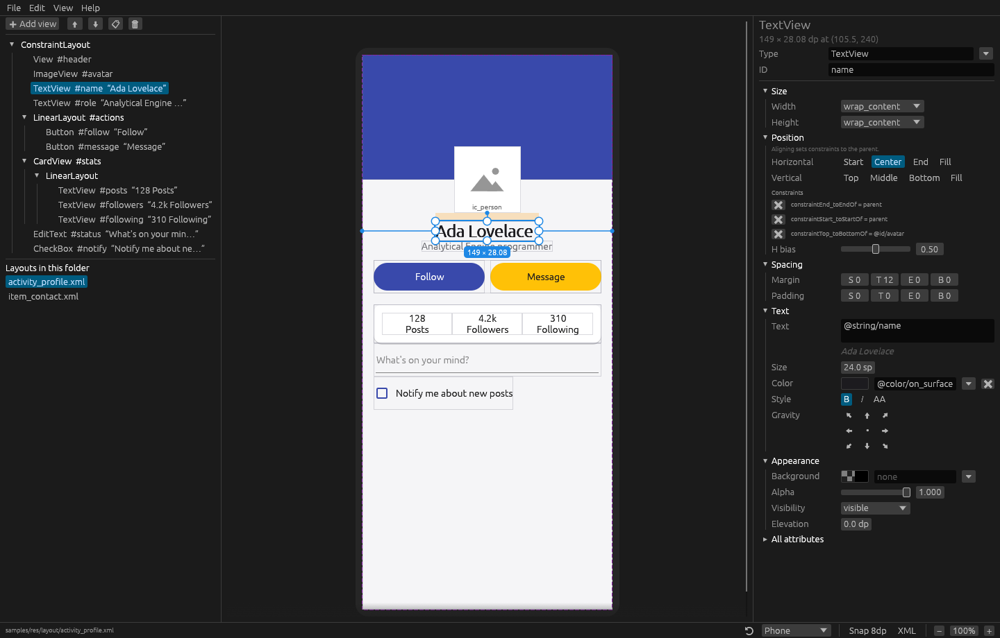

# layoutsmith

A desktop tool, written in Rust, for opening Android layout XML files and changing their design visually: move views, resize them, align them, restyle and recolor them. Every change is written back as a small edit to the XML, so the file stays clean in version control.



## Features

- **Live preview** of the layout on a phone, tablet or desktop-sized screen, portrait or landscape.
  - It uses a measure and layout engine modeled on Android's.
  - Supported containers: `LinearLayout` (weights, gravity), `FrameLayout`, `RelativeLayout`, `ConstraintLayout` (constraints, bias, `0dp` match-constraints) and `ScrollView`.
- **Move** views by dragging them. layoutsmith writes whatever the parent understands:
  - margins in a `FrameLayout` or `RelativeLayout`
  - margins, bias or a new constraint in a `ConstraintLayout`
  - a new position among the children in a `LinearLayout`

  Drop a view onto another container to move it inside. Arrow keys nudge by 1dp (Shift: 8dp).
- **Resize** with the handles. The view keeps its anchoring: a view pinned to the end stays pinned to the end.
- **Align** start, center, end or fill on each axis, with one click.
- **Style** from the inspector:
  - size: `match_parent`, `wrap_content`, fixed, match-constraints, weight
  - margins and padding
  - text, size, color, bold, italic, all caps and gravity
  - background, tint, alpha, visibility, elevation, card color and corner radius
  - image source, scale type and tint
- **Colors** with a color picker, or chosen from the project's own `@color/…` values.
- **Your project's resources**: `@color`, `@dimen`, `@string`, styles, `textAppearance` and theme attributes such as `?attr/colorPrimary` are read from `res/values/`, so the preview matches your app.
- **Lossless editing**: comments, attribute order, quoting and indentation are kept exactly as they were. Untouched files save byte for byte, and edits only change the attributes involved. New attributes follow the file's formatting.
- **Safe structure changes**:
  - Deleting a view, or moving it out of a `ConstraintLayout` or `RelativeLayout`, re-attaches the siblings that were positioned relative to it.
  - Duplicating a view gives the copy fresh ids.
- **View tree** with move up and down, duplicate and delete, plus a palette of common views.
- **XML panel** to read or edit the source directly.
- Undo and redo for everything, a list of the other layouts in the same folder, and drag-and-drop to open files.

## Getting started

You need a recent stable Rust toolchain (1.95 or newer).

```sh
git clone https://github.com/iiD4x/layoutsmith
cd layoutsmith
cargo run --release -- path/to/app/src/main/res/layout/activity_main.xml
```

Run it without a file to get a welcome screen with **Open**, **New layout** and **Try the sample**. The `samples/` folder contains a small Android `res` tree to play with.

Open layouts from inside your Android project (`…/res/layout/…`) so layoutsmith can find `res/values/` next to them.

### Linux

At runtime you need an X11 or Wayland session with OpenGL, plus `libxkbcommon-x11` (Debian and Ubuntu: `sudo apt install libxkbcommon-x11-0`). The open and save dialogs use the XDG desktop portal. If no portal is available, pass the file on the command line instead.

## Using it

| Action | How |
| --- | --- |
| Select | Click a view on the canvas or in the tree. Esc selects the parent. |
| Move | Drag the view. In a LinearLayout, dragging reorders. |
| Move into a container | Drag and drop onto the container (it is outlined in green). |
| Resize | Drag one of the eight handles. Turn on **Snap 8dp** for grid sizes. |
| Nudge | Arrow keys (1dp), Shift + arrow keys (8dp). |
| Align | **Position** section of the inspector. |
| Add a view | **Add view** above the tree, or right-click a container in the tree. |
| Duplicate / delete | Ctrl+D / Del |
| Undo / redo | Ctrl+Z / Ctrl+Shift+Z (or Ctrl+Y) |
| Save / save as | Ctrl+S / Ctrl+Shift+S |
| Zoom | Ctrl + mouse wheel, or the buttons in the status bar. |

## How it works

The workspace has two crates:

- **`layoutsmith-core`**: no GUI dependencies.
  - `xml`: a lossless XML model. Every byte of whitespace, quoting and comments survives a round trip.
  - `layout`: a simplified version of Android's measure and layout passes (`MeasureSpec`s, weights, gravity, RelativeLayout rules, constraints with bias), producing a rectangle for every view.
  - `edit`: design operations (move, resize, align, reparent, duplicate, insert) expressed as minimal attribute changes for each kind of parent.
  - `resources`: `res/values` lookup.
  - `history`: undo and redo.
- **`layoutsmith`**: the [egui](https://github.com/emilk/egui) desktop app (canvas, view tree, inspector).

```sh
cargo test     # core tests, including end-to-end checks against samples/
cargo clippy --all-targets
```

## Limitations

The preview is an approximation, not a pixel-exact Android renderer.

- Drawables, vector images and custom views are shown as placeholders.
- Text uses egui's bundled font rather than Roboto.
- ConstraintLayout chains, guidelines, barriers and dimension ratios are not modeled yet.
- `<include>` is shown as a placeholder.
- Only the default `values/` folder is read (no `values-night`, no qualifiers).

## License

MIT, see [LICENSE](LICENSE).
